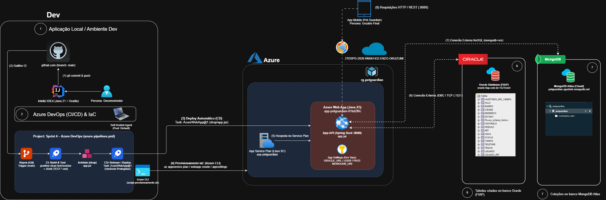

# PetGuardian API — DevOps Tools & Cloud Computing

> **FIAP Challenge 2026 — 2º Ano (ADS) | 2º Semestre — 4ª Sprint**  
> **Disciplina:** DevOps Tools & Cloud Computing  
> **Professor:** Antonio Sergio Rodrigues Figueiredo

<p align="left">
  
  
  
  
  
  
  
  
</p>

---

## 📌 Links Rápidos do Projeto

| Recurso | Descrição | Link |
|---|---|---|
| 🌐 **API em Produção (Azure Web App)** | Endpoint base do App Service provisionado | https://app-petguardian-01bd2f0c.azurewebsites.net |
| 🛡️ **Console Web Admin (Produção)** | Interface web visual para administração e auditoria | https://app-petguardian-01bd2f0c.azurewebsites.net/admin |
| 📖 **Swagger UI Interativo (Produção)** | Console interativo OpenAPI 3.1 com todos os endpoints | https://app-petguardian-01bd2f0c.azurewebsites.net/swagger-ui/index.html |
| 🩺 **Actuator Health (Observabilidade)** | Healthcheck em tempo real (Oracle + MongoDB + Liveness) | https://app-petguardian-01bd2f0c.azurewebsites.net/actuator/health |
| 🚀 **Projeto no Azure DevOps** | Organização PetGuardian / Sprint 4 – Azure DevOps | https://dev.azure.com/PetGuardian/Sprint%204%20%E2%80%93%20Azure%20DevOps |
| 💻 **Repositório GitHub (DevOps)** | Repositório com IaC e esteira de CI/CD | https://github.com/Challenge-Pet-Guardian-4/DevOps-Tools-Cloud-Computing |
| ☕ **Repositório GitHub (Java Advanced)** | Código-fonte da aplicação Spring Boot e 123 testes | https://github.com/Challenge-Pet-Guardian-4/Java-Advanced |
| 📄 **Documentação Oficial (PDF)** | Relatório técnico consolidado da Sprint 4 (DevOps & Cloud) | [Documentação DevOps Sprint 4 - Pet Guardian.pdf](./docs/Documenta%C3%A7%C3%A3o%20DevOps%20Sprint%204%20-%20Pet%20Guardian.pdf) |
| 🎥 **Vídeo Demonstrativo (YouTube)** | Apresentação em vídeo com passo a passo exigido | *Link do YouTube a ser anexado* |

---

## 👥 Integrantes

| Nome | RM | Turma | GitHub | LinkedIn |
| :--- | :---: | :---: | :--- | :--- |
| **Enzo Okuizumi** | **561432** | 2TDSPG | [EnzoOkuizumiFiap](https://github.com/EnzoOkuizumiFiap) | [Enzo Okuizumi](https://www.linkedin.com/in/enzo-okuizumi-b60292256/) |
| **Gustavo Okada** | **563428** | 2TDSPG | [Gdev3356](https://github.com/Gdev3356) | [Gustavo Okada](https://www.linkedin.com/in/gustavo-okada-53a3b8359/) |
| **Lucas Barros Gouveia** | **566422** | 2TDSPG | [LuzBGouveia](https://github.com/LuzBGouveia) | [Lucas Barros Gouveia](https://www.linkedin.com/in/lucas-barros-gouveia-09b147355/) |
| **Luna de Carvalho Guimarães** | **562290** | 2TDSPG | [lunaguima](https://github.com/lunaguima) | [Luna Guimarães](https://www.linkedin.com/in/luna-guimar%C3%A3es-b0ba82309/) |
| **Milton Marcelino** | **564836** | 2TDSPG | [MiltonMarcelino](https://github.com/MiltonMarcelino) | [Milton Marcelino](https://www.linkedin.com/in/milton-marcelino-250298142) |

---

## 1. 📖 Descrição da Solução

O **PetGuardian** é uma plataforma corporativa para governança colaborativa de cuidados e saúde de animais de estimação sob a **Arquitetura Pet-Centric**. A solução une:
* **Rede de Cuidado Compartilhado (Care Circle):** Divisão de responsabilidades entre múltiplos tutores/cuidadores com níveis de acesso granulares (Tutor Principal e Co-cuidadores).
* **Rotina Gamificada:** Tarefas de rotina clínica e alimentar com ciclo de vida automatizado (`PENDENTE`, `CONCLUIDO`, `EXPIRADO`), pontuação de bem-estar acumulada e desmarcação auditável.
* **Persistência Poliglota Integrada:** Dados relacionais estritos em 3FN com procedures no **Oracle Database 19c** corporativo da FIAP + Documentos didáticos extensos em Markdown no **MongoDB Atlas** na Nuvem.
* **Segurança Corporativa:** Autenticação stateless via **JWT com chaves assimétricas RSA 2048-bit** e controle de acesso baseado em papéis (**RBAC**: `COMUM`, `PREMIUM`, `ADMIN`).

### 🛠️ Stack Tecnológica

| Componente | Tecnologia | Finalidade |
|---|---|---|
| **Linguagem & Runtime** | Java 21 LTS | Linguagem oficial de backend (LTS) |
| **Framework Base** | Spring Boot 4.1.1 | Ecossistema REST corporativo com Spring Data, Security e Actuator |
| **Gerenciador de Build** | Gradle 8.x (Gradle Wrapper) | Automação determinística de compilação, geração de chaves RSA e testes |
| **Banco de Dados Relacional** | Oracle Database 19c (FIAP Cloud) | Persistência relacional em 3FN, triggers e Stored Procedures (`PKG_PETGUARDIAN`) |
| **Banco de Dados NoSQL** | MongoDB Atlas Cloud | Armazenamento de conteúdos ricos em Markdown das aulas educativas |
| **Nuvem de Hospedagem** | Microsoft Azure App Service (Linux) | Host de execução contínua com plano dedicado B1 (`app-petguardian-01bd2f0c`) |
| **Esteira de CI/CD** | Azure DevOps Pipelines | Automação completa de compilação, execução de testes, geração de artefato e deploy |
| **Agente de Execução** | Self-Hosted Agent (Windows) | Agente dedicado executando no pool `Default` sem restrições de concorrência ou quotas |
| **Infraestrutura como Código (IaC)** | Azure CLI / Bash (`script-provisionamento.sh`) | Provisionamento automatizado e idempotente do Resource Group, Plan e Web App |

---

## 2. 🏛️ Arquitetura da Solução & Diagrama do Fluxo CI/CD

<p align="center">
  
</p>

O diagrama a seguir detalha a jornada de ponta a ponta, conectando as personas (**Desenvolvedor** e **Usuário Final**), os componentes de computação e dados, e as 8 etapas numeradas da esteira de Integração e Entrega Contínuas (**CI/CD**):

```
+-----------------------------------------------------------------------------------------------------------------+
|                                   ARQUITETURA CLOUD & FLUXO DESTEIRA CI/CD                                      |
+-----------------------------------------------------------------------------------------------------------------+

 [🧑‍💻 Desenvolvedor] 
         │
         │ [1] git push origin main
         ▼
 ┌────────────────────────────────────────┐
 │   Azure Repos / GitHub Repository      │
 └───────────────────┬────────────────────┘
                     │ [2] Gatilho Automático (CI Trigger)
                     ▼
 ┌─────────────────────────────────────────────────────────────────────────────────┐
 │ AZURE DEVOPS PIPELINES (Sprint 4 – Azure DevOps)                                │
 │                                                                                 │
 │   ┌─────────────────────────────────────────────────────────────────────────┐   │
 │   │ ETAPA 1: CI (Continuous Integration) — Agente Self-Hosted (Pool Default)│   │
 │   │                                                                         │   │
 │   │   [3] Execução do Gradle Wrapper:                                       │   │
 │   │       `call gradlew.bat clean test bootJar --no-daemon`                 │   │
 │   │                                                                         │   │
 │   │   [4] Execução da Suíte de Testes Automatizados:                        │   │
 │   │       123 Testes de Integração e Unidade (JUnit 5 + Mockito)            │   │
 │   │                                                                         │   │
 │   │   [5] Publicação de Resultados de Testes:                               │   │
 │   │       `PublishTestResults@2` -> Relatório XML no Azure DevOps           │   │
 │   │                                                                         │   │
 │   │   [6] Empacotamento e Publicação de Artefato:                           │   │
 │   │    `PublishBuildArtifacts@1` -> Gera container de artefato: drop/app.jar│   |
 │   └────────────────────────────────────┬────────────────────────────────────┘   │
 │                                        │                                        │
 │                                        │ [7] Gatilho de Deploy (CD Automático)  │
 │                                        ▼                                        │
 │   ┌─────────────────────────────────────────────────────────────────────────┐   │
 │   │ ETAPA 2: CD (Continuous Deployment) — Deploy Automático                 │   │
 │   │                                                                         │   │
 │   │   [8] Task `AzureWebApp@1`:                                             │   │
 │   │       Service Connection: `PetGuardian-Connection`                      │   │
 │   │       Deploy via Kudu ZIP Deploy de `drop/app.jar` para o App Service   │   │
 │   └────────────────────────────────────┬────────────────────────────────────┘   │
 └────────────────────────────────────────┼────────────────────────────────────────┘
                                          │
                                          │ Deploy do JAR Executável
                                          ▼
 ┌─────────────────────────────────────────────────────────────────────────────────┐
 │ MICROSOFT AZURE CLOUD (Resource Group: rg-petguardian | Região: East US)        │
 │                                                                                 │
 │   ┌─────────────────────────────────────────────────────────────────────────┐   │
 │   │ Azure App Service: `app-petguardian-01bd2f0c` (Plano:asp-petguardian B1)│   │
 │   │ Runtime: Java 21 Java SE (Linux)                                        │   │
 │   │ Startup: `java -jar /home/site/wwwroot/app.jar`                         │   │
 │   │ Porta: 8080 (WEBSITES_PORT=8080)                                        │   │
 │   └───────────────────┬─────────────────────────────────┬───────────────────┘   │
 └───────────────────────┼─────────────────────────────────┼───────────────────────┘
                         │                                 │
                         │ JDBC Thin (Porta 1521)          │ MongoDB Wire Protocol (TLS 27017)
                         ▼                                 ▼
         ┌───────────────────────────────┐ ┌─────────────────────────────────┐
         │ Oracle Database 19c           │ │ MongoDB Atlas (Cloud NoSQL)     │
         │ (FIAP Cloud: oracle.fiap.com) │ │ (`petguardian.agoderb.mongodb`) │
         │                               │ │                                 │
         │ • 15 Tabelas Relacionais 3FN  │ │ • Coleção: `conteudos_aula`     │
         │ • Package `PKG_PETGUARDIAN`   │ │ • Textos Ricos em Markdown      │
         │ • Triggers e Sequences        │ │ • Módulos Didáticos & Multimídia│
         └───────────────────────────────┘ └─────────────────────────────────┘
                         ▲
                         │ HTTPS (Porta 443) / Swagger UI / REST API
                         │
                 [👥 Usuário Final / Tutor / Cuidador]
```

### 🔢 Descrição Detalhada das 8 Etapas da Esteira:

1. **Gatilho de Código (`git push`):** O desenvolvedor envia novos commits para a branch monitorada (`main`).
2. **Disparo Automático do CI:** O Azure DevOps detecta a alteração via webhook e inicia imediatamente a execução da pipeline `azure-pipelines.yml`.
3. **Inicialização do Agente Self-Hosted:** O agente local (registrado no pool `Default`) aloca a execução do job `Compilação Gradle e Testes` em ambiente com JDK 21 e Gradle Wrapper.
4. **Execução de Build e Testes:** O comando `gradlew.bat clean test bootJar` compila o código-fonte, gera as chaves assimétricas RSA dinamicamente e executa **123 testes JUnit** cobrindo segurança RBAC, regras de negócio e integração de banco de dados.
5. **Publicação dos Testes:** A tarefa `PublishTestResults@2` lê os arquivos XML gerados em `build/test-results/test/TEST-*.xml` e publica a aba interativa de testes no Azure DevOps.
6. **Publicação do Artefato:** A tarefa `PublishBuildArtifacts@1` copia o arquivo binário compilado `app.jar` para a área de staging e disponibiliza o artefato nomeado `drop`.
7. **Disparo do Estágio CD:** Condicionado ao sucesso de 100% dos testes do estágio de CI, o estágio de CD (`Deploy para Azure Web App`) é iniciado automaticamente.
8. **Deploy no Azure App Service:** A tarefa `AzureWebApp@1` autentica via Service Connection (`PetGuardian-Connection`) e realiza o deploy atômico (ZIP Deploy) do `app.jar` no Azure Web App Linux, reiniciando o serviço sem indisponibilidade.

---

## 3. ☁️ Bancos de Dados em Nuvem (Requisito 3/8)

Para atender estritamente às exigências da Sprint 4 (utilização de banco de dados em nuvem via PaaS ou instâncias gerenciadas), a solução implementa uma arquitetura poliglota:

### A) Banco Relacional Corporativo — Oracle Database 19c (FIAP Cloud)
* **Host:** `oracle.fiap.com.br:1521/orcl`
* **Schema / Usuário:** `RM561432`
* **Finalidade:** Persistência estrita em Terceira Forma Normal (3FN), chaves estrangeiras, índices e execução do pacote PL/SQL corporativo `PKG_PETGUARDIAN`.
* **Migrações:** Gerenciadas automaticamente pelo **Flyway** (`flyway-database-oracle`) no boot da aplicação.

### B) Banco NoSQL em Nuvem — MongoDB Atlas
* **Cluster:** `petguardian.agoderb.mongodb.net`
* **Coleção:** `conteudos_aula`
* **Finalidade:** Armazenamento de textos longos pedagógicos em Markdown, links audiovisuais e metadados didáticos com flexibilidade de esquema.
* **Segurança:** Conexão criptografada por TLS/SSL e liberação de regras de acesso em **Network Access** (`0.0.0.0/0` para permitir a conectividade com os IPs dinâmicos de saída do Azure Web App).

---

## 4. ⚙️ Configuração do Projeto no Azure DevOps (Requisitos 4/8 e 5/8)

O ambiente no Azure DevOps foi configurado seguindo rigorosamente os padrões solicitados pela banca avaliadora:

* **Nome da Organização:** `PetGuardian` (URL: `https://dev.azure.com/PetGuardian`)
* **Nome do Projeto (Project Name):** `Sprint 4 – Azure DevOps`
* **Descrição do Projeto:** `Projeto para entrega da Sprint 4 do professor Antonio Sergio Rodrigues Figueiredo`
* **Visibilidade:** `Private`
* **Controle de Versão:** `Git`
* **Processo de Itens de Trabalho (Work Item Process):** `Agile`
* **Acesso ao Professor:** Usuário do professor convidado com nível de acesso **Basic** na organização e adicionado ao grupo **Project Administrators** do projeto.

### 🛡️ Variáveis de Ambiente Protegidas (Secrets)

Nenhuma senha, token ou credencial sensível é versionada no repositório Git. As variáveis são injetadas de forma protegida:

1. **Na Pipeline do Azure DevOps (Library / Pipeline Variables como Secret):**
   * `ORACLE_URL`: String de conexão JDBC Thin do Oracle FIAP.
   * `ORACLE_USER`: Usuário do schema (`RM561432`).
   * `ORACLE_PASSWORD`: Senha de acesso ao Oracle (mascarada com cadeado).
   * `MONGODB_URI`: String de conexão segura do MongoDB Atlas com credenciais.
   * `ADMIN_BCRYPT_HASH`: Hash BCrypt da senha mestra de administrador.

2. **No Azure Web App (App Service > Configuration > Application Settings):**
   * Todas as variáveis acima encontram-se espelhadas como variáveis de ambiente de sistema operacional no container Linux, garantindo execução sem dependência de arquivos locais.

---

## 5. 📜 Script de Provisionamento de Infraestrutura (`script-provisionamento.sh`)

O repositório inclui o script automatizado [`script-provisionamento.sh`](./script-provisionamento.sh), desenvolvido em Bash utilizando o **Azure CLI** para provisionamento declarativo e reprodutível de toda a infraestrutura em nuvem:

```bash
# Execução no terminal com Azure CLI autenticado:
chmod +x script-provisionamento.sh
./script-provisionamento.sh
```

### Recursos Provisionados pelo Script:
1. **Resource Group:** `rg-petguardian` (Região: `eastus`).
2. **App Service Plan:** `asp-petguardian` em Linux com SKU **B1** (Basic dedicado — 1.75 GB RAM, sem limite de horas diárias).
3. **Azure Web App:** `app-petguardian-01bd2f0c` configurado com runtime nativo `JAVA|21-java21`.
4. **Configuração Segura de App Settings:** Injeção das portas (`PORT=8080`, `WEBSITES_PORT=8080`) e URLs base de infraestrutura. Segredos de banco (`ORACLE_PASSWORD`, `MONGODB_URI`, `ADMIN_BCRYPT_HASH`) são parametrizados via variáveis de ambiente da sessão ou gerenciados no Application Settings do Azure / Pipeline Secrets do Azure DevOps (DevSecOps).

---

## 6. 🎥 Roteiro Passo a Passo para Gravação do Vídeo da Sprint 4

Para assegurar nota máxima sem sofrer os descontos previstos na tabela de penalidades do edital, siga este roteiro estruturado durante a gravação da apresentação:

| Passo | Tela / Ferramenta | O que Fazer e Falar | Critério Atendido |
|:---:|:---|:---|:---|
| **1** | IDE + Azure Portal + Azure DevOps | Apresentar as ferramentas abertas: VS Code / IDE, Portal do Azure (Resource Group `rg-petguardian`), Azure DevOps (Repositório e Pipelines) e cliente de Banco de Dados. | *Ferramentas preparadas e visíveis* |
| **2** | Azure DevOps > Pipelines | Abrir a pipeline `azure-pipelines.yml`, explicar os dois estágios (**CI** e **CD**), as variáveis protegidas e a Service Connection `PetGuardian-Connection`. | *Apresentação da configuração da pipeline* |
| **3** | IDE (Código da Aplicação) | Fazer uma alteração simples e visível no código Java (ex: alterar a descrição de uma rota no Swagger ou adicionar um log visível). | *Alteração efetuada em código* |
| **4** | Terminal / Git | Executar `git add .`, `git commit -m "feat: alteracao demonstrativa video"` e `git push`. Mostrar no Azure DevOps o disparo automático da esteira. | *Disparo automático em push na branch* |
| **5** | Azure DevOps > Run da Pipeline | Abrir os logs em tempo real e comentar cada etapa: compilação Gradle, execução dos testes, geração do artefato e deploy no Web App. | *Explicação de cada etapa do CI/CD* |
| **6** | Azure DevOps > Testes e Artefatos | Mostrar a aba **Tests** com os **123 testes JUnit aprovados** (100% de sucesso) e a aba de **Artifacts** com o pacote `drop/app.jar` publicado. | *Evidência de testes e artefato publicado* |
| **7** | Portal do Azure | Abrir o Web App `app-petguardian-01bd2f0c`, mostrar status `Running`, o plano `asp-petguardian` e o histórico de deploy atualizado pelo Azure DevOps. | *Recursos atualizados pelo deploy no Azure* |
| **8** | Navegador (Swagger UI em Produção) | Acessar `https://app-petguardian-01bd2f0c.azurewebsites.net/swagger-ui/index.html` e demonstrar as operações do **CRUD completo** (Cadastro de Usuário, Consulta, Atualização e Exclusão). | *Execução do CRUD na nuvem* |
| **9** | Cliente SQL (DBeaver / SQL Developer) | Executar `SELECT * FROM TB_USUARIO WHERE ...` diretamente no Oracle da FIAP comprovando que o dado foi persistido e refletido no banco. | *Evidência de persistência via SELECT* |

---

## 7. 📁 Estrutura de Arquivos deste Repositório

```
DevOps-Tools-Cloud-Computing/
├── docs/                                                 # Documentação e diagramas arquiteturais
│   ├── Documentação DevOps Sprint 4 - Pet Guardian.pdf  # Documento técnico oficial consolidado em PDF
│   ├── challenge4-petguardian-diagrama.drawio           # Diagrama em formato editável Draw.io
│   └── challenge4-petguardian-diagrama.png              # Diagrama de arquitetura em nuvem renderizado
├── azure-pipelines.yml                                   # Definição oficial em YAML da esteira de CI/CD (Build, Testes, Artefato e Deploy)
├── script-provisionamento.sh                             # Script Bash (Azure CLI) para criação do RG, App Service Plan e Web App
└── README.md                                             # Documentação técnica completa da Sprint 4
```

---

> **PetGuardian API** — Cuidado colaborativo com governança, engenharia de confiabilidade e automação em nuvem.